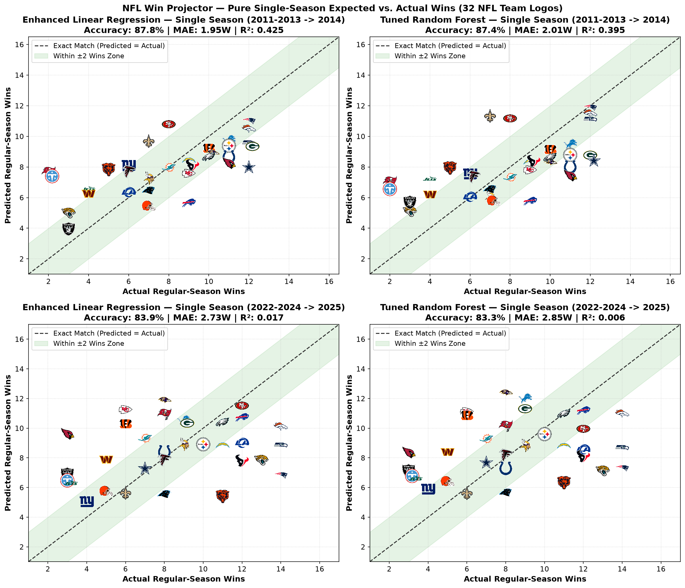
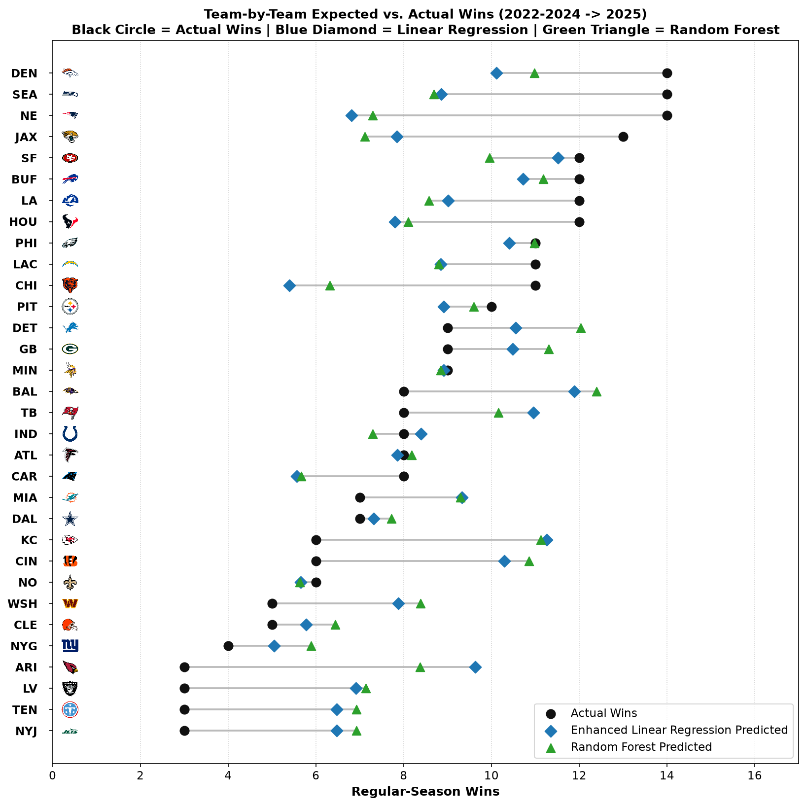
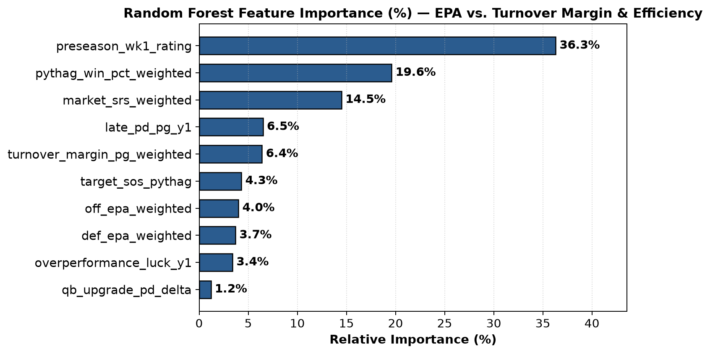

# NFL Regular-Season Win Predictor

A machine learning pipeline that predicts NFL regular-season win totals prior to Week 1 using a rolling 3-year window of play-by-play efficiency, scoring, turnover, schedule, quarterback change, and market power rating metrics (`1999–2025`).

---

## Overview

Predicting single-season NFL records before the season starts is a challenging regression problem due to the short 16–17 game schedule, year-to-year parity, and in-season injury variance. This project pulls and cleans 27 seasons of play-by-play (~858,000 plays) and schedule data (6,967 games) via [`nfl_data_py`](https://github.com/nflverse/nfl_data_py), constructs 24 rolling 3-year $\rightarrow$ 1-year windows (`1999–2001 -> 2002` through `2022–2024 -> 2025`), and compares two regression architectures:

1. **Multiple Linear Regression**
   - *Baseline Linear Regression*: 4 unweighted 3-year average features predicting raw wins.
   - *Enhanced Linear Regression*: 10 recency-weighted and era-normalized features predicting win percentage, calibrated with Reduced Major Axis (RMA) dispersion scaling.
2. **Tuned Random Forest Regressor**
   - Regularized tree depth (`max_depth=4..5`) and minimum leaf size (`min_samples_leaf=3..5`) selected via Leave-One-Window-Out cross-validation to prevent small-sample overfitting.

---

## Feature Engineering

For each rolling window $(t-3, t-2, t-1) \rightarrow t$, play-by-play noise (penalties, QB kneel-downs, and spikes) is filtered out and relocated franchises (`OAK -> LV`, `SD -> LAC`, `STL -> LA`, `WAS -> WSH`) are standardized. Annual metrics are aggregated with recency weights $(0.10, 0.20, 0.70)$:

| Feature | Description |
| :--- | :--- |
| `off_epa_weighted` | Recency-weighted offensive Expected Points Added (EPA) per play |
| `def_epa_weighted` | Recency-weighted defensive EPA allowed per play |
| `pythag_win_pct_weighted` | Recency-weighted NFL Pythagorean win expectation ($PF^{2.37} / (PF^{2.37} + PA^{2.37})$) |
| `turnover_margin_pg_weighted` | Recency-weighted turnover margin per game (takeaways minus giveaways) |
| `overperformance_luck_y1` | Prior-season ($t-1$) close-game luck (actual win % minus Pythagorean win %) |
| `late_pd_pg_y1` | Second-half momentum: point differential per game in Weeks $\ge 10$ of season $t-1$ |
| `qb_upgrade_pd_delta` | Above-average Empirical Bayes shrunk prior point differential delta of incoming vs. outgoing Week 1 QB |
| `market_srs_weighted` | Iterative opponent-adjusted Simple Rating System (SRS) on historical point spreads |
| `preseason_wk1_rating` | Pre-season Week 1 opening line rating anchored to the opponent's prior-window rating |
| `target_sos_pythag` | Pre-season Strength of Schedule (average prior-window Pythagorean win % of season-$t$ opponents) |

---

## Results Summary

### 1. Walk-Forward Expanding-Window Backtest (21 Out-of-Sample Seasons, 2005–2025)
Models are trained only on prior historical windows and evaluated out-of-sample on the next chronological season across 672 team-seasons:

| Model Architecture | Single-Season Accuracy (%) | Record .500+ Acc (%) | Within $\pm 2$ Wins (%) | Overall MAE (Wins) | Overall $R^2$ |
| :--- | :---: | :---: | :---: | :---: | :---: |
| **Baseline Linear Regression (4 features)** | 85.16% | 61.8% | 55.7% | 2.408 | 0.143 |
| **Enhanced Linear Regression (10 features)** | **85.79%** | 63.7% | **60.7%** | **2.307** | **0.168** |
| **Tuned Random Forest Regressor** | 85.42% | **64.7%** | 60.0% | 2.365 | 0.136 |

* **Peak Single Season (`2018-2020 -> 2021`)**: Random Forest reached **90.6% accuracy** (`1.605 MAE`) and Enhanced Linear Regression reached **89.8% accuracy** (`1.732 MAE`).

### 2. Held-Out Multi-Era Test Windows
All 24 windows are partitioned into 19 training windows and 5 held-out test seasons across different NFL eras:

| Held-Out Test Window | Baseline LR MAE | Enhanced LR Acc (MAE / $R^2$) | Random Forest Acc (MAE / $R^2$) |
| :--- | :---: | :---: | :---: |
| **`2002-2004 -> 2005`** | 2.88W | 82.50% (2.80W / $0.087$) | **83.84%** (**2.59W** / **$0.178$**) |
| **`2007-2009 -> 2010`** | 2.28W | 84.97% (2.40W / $0.072$) | **85.87%** (**2.26W** / **$0.095$**) |
| **`2011-2013 -> 2014`** | 2.19W | **87.82%** (**1.95W** / **$0.426$**) | 87.42% (2.01W / $0.396$) |
| **`2014-2016 -> 2017`** | 2.30W | **87.51%** (**2.00W** / **$0.358$**) | 86.51% (2.16W / $0.334$) |
| **`2022-2024 -> 2025`** | 2.83W | **83.92%** (**2.73W** / **$0.017$**) | 83.26% (2.85W / $0.006$) |

---

## Diagnostic Visualizations

### Pure Single-Season Expected vs. Actual Wins (2014 & 2025)


### 2025 Team-by-Team Expected vs. Actual Wins Comparison


### Random Forest Feature Importance


---

## Project Structure

```text
nfl-record-predictor/
├── nfl_win_projector.py               # Main data pipeline, feature engineering, training & evaluation script
├── requirements.txt                   # Python dependencies
├── plots/                             # Generated evaluation plots
│   ├── actual_vs_predicted_scatter.png
│   ├── prediction_error_residuals.png
│   └── rf_feature_importance.png
└── README.md
```

---

## Installation & Usage

1. **Install dependencies**:
   ```bash
   pip install -r requirements.txt
   ```

2. **Run the pipeline**:
   ```bash
   python3 nfl_win_projector.py
   ```
   - On the first run, play-by-play and schedule datasets (`1999–2025`) and team logos are downloaded via `nfl_data_py` and cached locally in `.cache/` as Parquet files for fast subsequent runs.
   - To test different historical ranges, edit `TEST_WINDOWS` at the top of `nfl_win_projector.py`.
